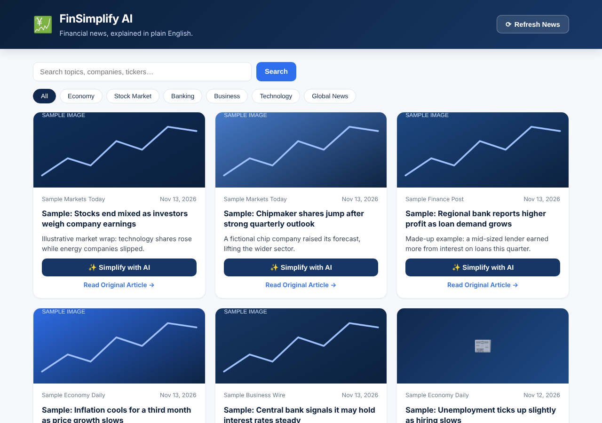
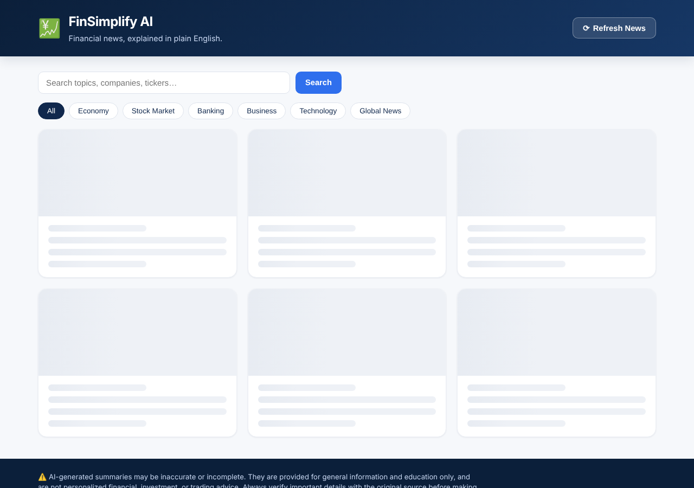
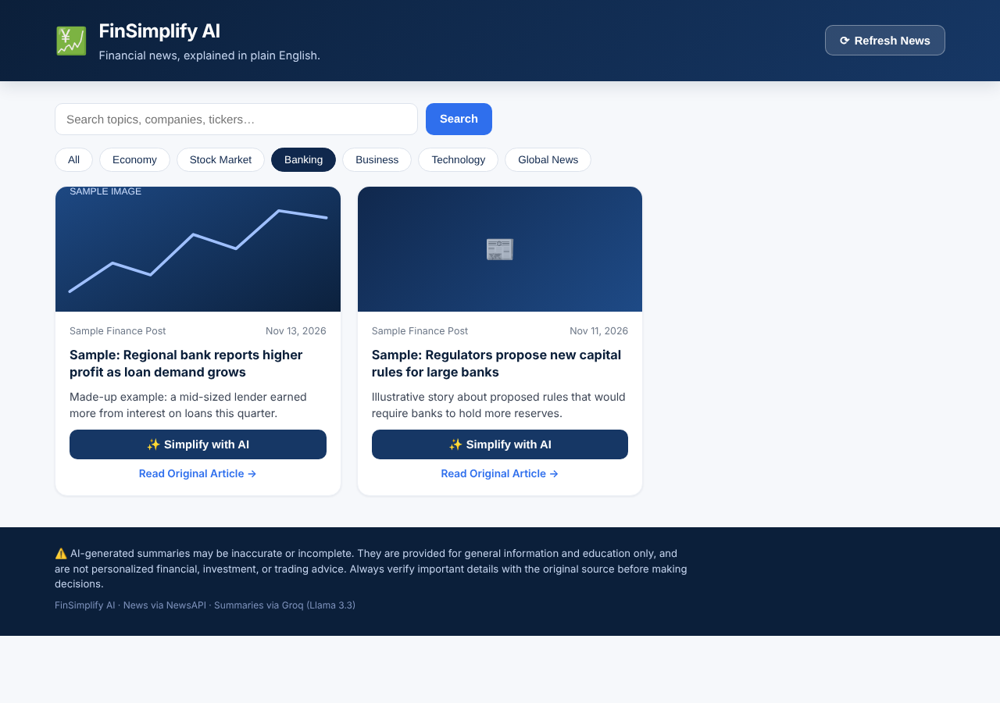
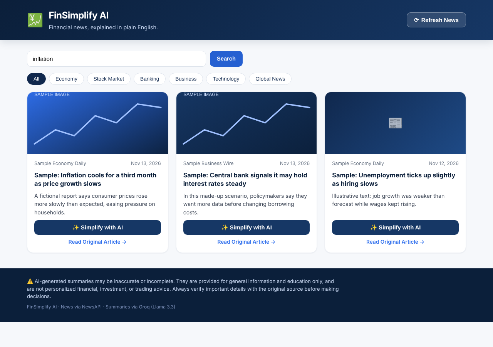
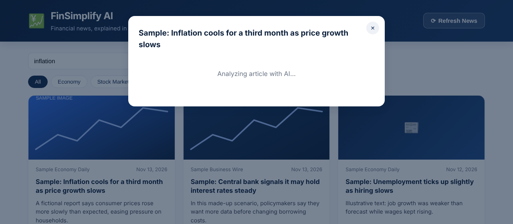
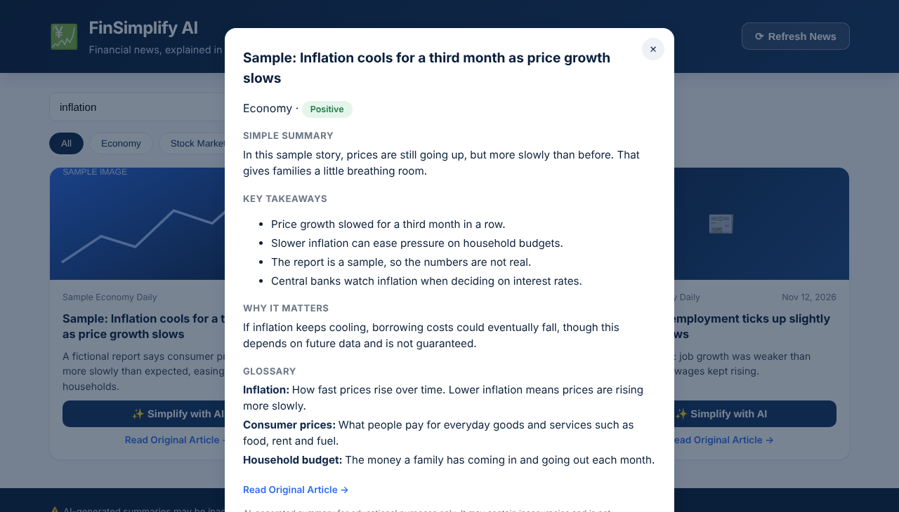
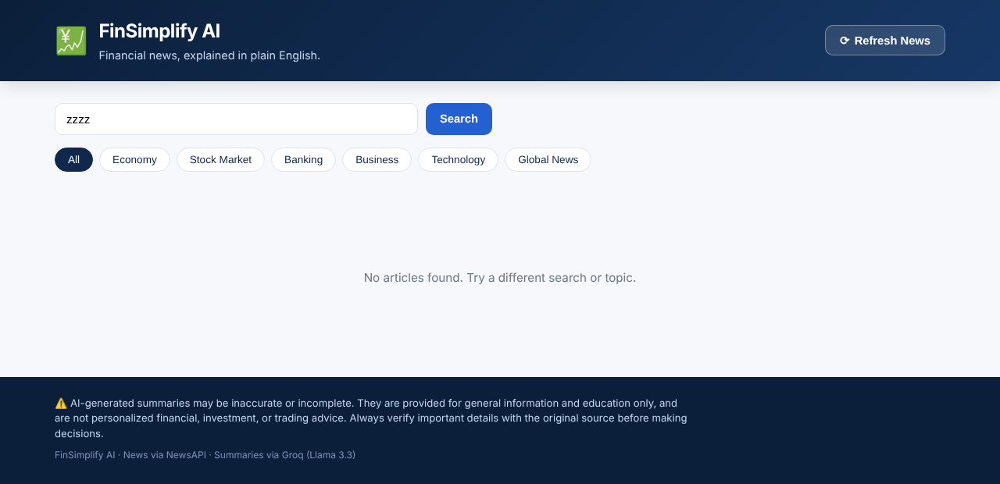
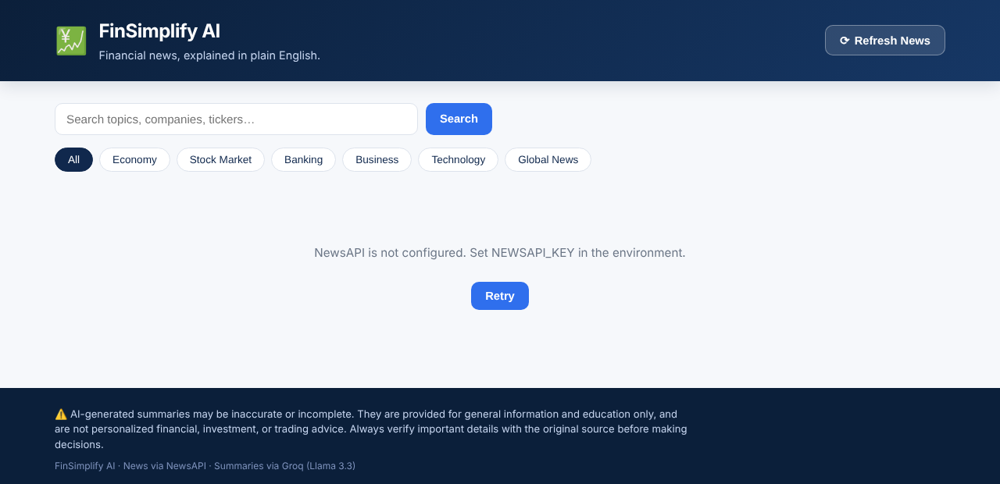
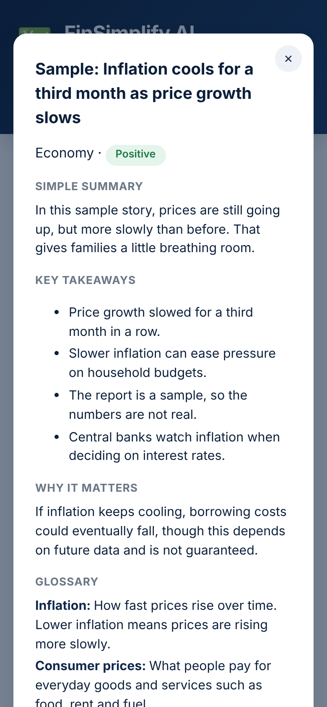

# FinSimplify AI - Project Documentation

Version 1.0 - November 14, 2026

## 1. Overview

FinSimplify AI is a web application that turns financial news into plain English. It fetches recent business and economic articles from NewsAPI, sends a chosen article to Groq's Llama 3.3 70B model, and shows a short summary, key takeaways, why the story matters, a cautious sentiment label and a small glossary of financial terms.

It is designed for students, beginners in finance, investors and busy professionals who want the gist of a story without the jargon.

**About the screenshots.** The screenshots in this document were taken from the real application running in a headless Chromium browser. Because live NewsAPI and Groq keys were not available, the app was pointed at a small local stand-in for the two services (the base URLs are configurable). Every article and AI answer you see is therefore **clearly labeled sample content**, not real news and not real model output. With your own keys, the same screens show live articles and live summaries.

### Key features

- Live news feed from NewsAPI with free-text search and six topic filters.
- "Simplify with AI" on every article: summary, key takeaways, why it matters, sentiment and glossary.
- Prompts that treat article text as untrusted data and ask the model to separate facts from possible implications.
- Loading skeletons, empty states, retry buttons and friendly error messages.
- Responsive layout for desktop and mobile, navy and white theme.
- Secrets stay on the server; article and AI text is rendered safely with `textContent`.
- Automated tests with mocked external APIs (no real keys needed).

## 2. Quick start

### One-click launch

1. Install Python 3.11 or newer.
2. Create free keys: NewsAPI at newsapi.org/register and Groq at console.groq.com/keys.
3. Start the app:
   - Windows: double-click `start.bat`
   - macOS: double-click `start.command` (first time: right-click, then Open)
   - Linux: run `./start.sh`
4. On the first run a `.env` file opens. Paste both keys and save. On macOS and Linux, run the launcher again.

The launcher creates a virtual environment, installs dependencies, starts the server and opens http://localhost:8000 in Chrome.

### Manual setup

```
python3 -m venv venv
source venv/bin/activate          (Windows: venv\Scripts\activate)
pip install -r requirements.txt
cp .env.example .env              (Windows: copy .env.example .env)
uvicorn app.main:app --reload
```

Then open http://localhost:8000.

## 3. Tour of the interface

### 3.1 Dashboard

The home page shows the FinSimplify AI header and tagline, a search bar, six topic filters and a grid of news cards. Each card shows an image (or a newspaper placeholder when the article has none), the source, the publication date, the headline and a short description. Every card has a **Simplify with AI** button and a **Read Original Article** link that opens the publisher's page in a new tab.



The **Refresh News** button in the header reloads the feed and clears the session's cached summaries.

### 3.2 Loading state

While news is being fetched, the grid shows skeleton cards so the page never looks empty or broken.



### 3.3 Topic filters

The filters are All, Economy, Stock Market, Banking, Business, Technology and Global News. Selecting one reloads the feed for that topic. NewsAPI has no dedicated stock-market feed, so each topic is approximated with a keyword query (see section 5).



### 3.4 Search

Type a topic, company or ticker into the search bar and press Search. A typed query takes priority over the selected topic.



### 3.5 Simplify with AI

Clicking **Simplify with AI** opens a panel and shows a progress message while the article is analyzed.



When the answer arrives, the panel shows:

- **Topic and sentiment** - a short topic label and a cautious positive, negative or neutral badge.
- **Simple Summary** - a few sentences in easy English.
- **Key Takeaways** - three to five short points.
- **Why It Matters** - the possible significance, worded with uncertainty where appropriate.
- **Glossary** - two to four financial terms explained simply.
- **Read Original Article** and an educational-use disclaimer.



Summaries are cached in memory for the browser session, so reopening the same article does not call the AI again. Press Escape, the close button or click outside the panel to close it.

### 3.6 Empty and error states

If a search matches nothing, the page says so. If something goes wrong (for example a missing API key), the page shows a clear message with a **Retry** button instead of a blank screen. The second screenshot below was taken from an instance started without keys, so it shows the real "not configured" message.





### 3.7 Mobile

The layout adapts to phones: the header stacks, filters wrap onto several lines, cards use a single column and the summary panel scrolls.

 

## 4. Architecture

The backend is a FastAPI application. It serves the frontend and a small JSON API, and talks to NewsAPI and Groq on the server so API keys never reach the browser.

| Layer | Technology | Responsibility |
|---|---|---|
| Frontend | HTML, CSS, vanilla JavaScript | Dashboard, filters, modal, safe rendering |
| API | FastAPI, Uvicorn, Pydantic | Routing, validation, error handling |
| News service | HTTPX | Query NewsAPI, normalize and deduplicate articles |
| AI service | HTTPX | Call Groq, validate the model's JSON |
| Config | python-dotenv | Read settings and secrets from the environment |

### Request flow

1. The browser loads `/`; FastAPI returns the dashboard and its static files.
2. The page calls `GET /api/news`. The news service queries NewsAPI, drops removed and duplicate articles and returns a clean list.
3. When the user clicks Simplify with AI, the page calls `POST /api/summarize`. The AI service sends the article to Groq in JSON mode, validates the answer and returns it.
4. The page renders everything with `textContent` and caches the summary for the session.

### Project layout

```
FinSimplify-AI/
  app/
    main.py              app setup, error handlers, static files
    config.py            settings from environment / .env
    routes/news.py       /api/health, /api/news, /api/summarize
    services/
      news_service.py    NewsAPI integration
      ai_service.py      Groq integration and prompt
    models/schemas.py    request and response models
    static/css, js       styles and frontend logic
    templates/index.html dashboard page
  tests/test_api.py      pytest suite
  docs/                  this documentation and screenshots
  start.bat start.sh start.command   one-click launchers
  .env.example  requirements.txt  README.md
```

## 5. API reference

### GET /api/health

Reports status and which providers are configured. It never returns secret values. An unedited `.env.example` counts as not configured.

```
{
  "status": "ok",
  "app_name": "FinSimplify AI",
  "environment": "development",
  "newsapi_configured": true,
  "groq_configured": true,
  "groq_model": "llama-3.3-70b-versatile"
}
```

`status` is `degraded` when either key is missing.

### GET /api/news

| Parameter | Description |
|---|---|
| `q` | Optional search text, up to 200 characters. Overrides `topic`. |
| `topic` | Optional: economy, stock_market, banking, business, technology, global_news |
| `page_size` | Number of articles, default 12, maximum 50 (configurable) |

```
curl "http://localhost:8000/api/news?topic=banking&page_size=10"
```

Each article contains an id, title, description, content snippet, url, image_url, source and published_at. Articles marked removed by NewsAPI, or with the same URL, are dropped. Missing images, descriptions and dates are handled gracefully.

### POST /api/summarize

```
curl -X POST http://localhost:8000/api/summarize \
  -H "Content-Type: application/json" \
  -d '{"title":"Example headline","description":"Short text","url":"https://example.com"}'
```

Title is required (up to 500 characters); description, content and url are optional (content and description up to 6,000 characters). The response contains `simple_summary`, `key_takeaways`, `why_it_matters`, `topic`, `sentiment`, `important_terms`, `model_used` and a `disclaimer`.

### Status codes

| Code | Meaning |
|---|---|
| 200 | Success |
| 400 | `page_size` above the allowed maximum |
| 422 | Invalid input (blank title, unknown topic, field too long) |
| 429 | NewsAPI or Groq rate limit reached |
| 502 | Upstream error, rejected key or unparseable AI answer |
| 503 | A required API key is not configured |
| 504 | Upstream request timed out |

### Topic queries

NewsAPI's general feed has no stock-market category, so topics map to keyword searches against `/v2/everything`, for example Economy uses inflation, GDP and interest rates, and Banking uses bank, banking and central bank. Results are sorted by publication time.

## 6. Configuration

Settings are read from environment variables (a local `.env` file is loaded automatically).

| Variable | Default | Purpose |
|---|---|---|
| `NEWSAPI_KEY` | none | NewsAPI key (required for news) |
| `GROQ_API_KEY` | none | Groq key (required for summaries) |
| `GROQ_MODEL` | llama-3.3-70b-versatile | Model name; change if Groq retires it |
| `GROQ_API_BASE` | Groq OpenAI-compatible URL | Groq endpoint base |
| `NEWSAPI_BASE_URL` | https://newsapi.org/v2 | NewsAPI base |
| `MAX_PAGE_SIZE` | 50 | Upper limit for `page_size` |
| `HTTP_TIMEOUT_SECONDS` | 12 | Timeout for upstream calls |
| `MAX_SUMMARIZE_FIELD_LENGTH` | 6000 | Text length sent to the AI |
| `CORS_ALLOWED_ORIGINS` | empty | Comma-separated allowlist; empty keeps CORS off |
| `HOST`, `PORT`, `ENVIRONMENT` | 0.0.0.0, 8000, development | Server settings |

## 7. How the AI is instructed

- Article text is fenced and labeled as untrusted data; instructions inside articles must be ignored.
- The model must not invent figures or claims and should say when information is missing.
- Reported facts are kept separate from possible implications, using cautious wording.
- Output is never personal financial advice or a guaranteed prediction.
- The model must return a single JSON object. The server strips code fences if present, validates every field, limits takeaways to five and terms to four, and falls back to "neutral" for unclear sentiment. If the answer cannot be parsed, the user sees a friendly retry message.

## 8. Security

- API keys exist only in server environment variables, never in frontend code, responses or logs.
- `.env` is excluded by `.gitignore`; only `.env.example` with placeholders is shared.
- External content is rendered with `textContent`, never `innerHTML`.
- Article links and images are only used when their URL is http or https; links open with `noopener noreferrer`.
- A global handler returns a generic 500 message, so stack traces never reach the browser.
- Inputs have length limits, and CORS is disabled unless an allowlist is configured.

## 9. Testing

Run the suite with `pytest tests/ -v`. It makes no real network calls: NewsAPI and Groq are mocked with respx, so no keys are needed. The latest run passed all 21 tests.

| Area | Cases covered |
|---|---|
| Health | Fully configured, missing keys, placeholder keys, no secrets in output |
| News | Success, deduplication, removed articles, query passthrough, invalid topic, page size limit |
| News errors | Missing key, rejected key, rate limit, network error |
| Summarize | Success, fenced JSON, malformed JSON, blank or missing title |
| Summarize errors | Missing key, rejected key, rate limit |
| Frontend | Index page and static files are served |

Browser checks during screenshot capture (Chromium) reported no console errors on the main pages. The launcher script `start.sh` was run end to end on Linux; `start.bat` and `start.command` were not run on Windows or macOS.

## 10. Troubleshooting

| Symptom | Fix |
|---|---|
| "NewsAPI is not configured" | Set `NEWSAPI_KEY` in `.env` and restart |
| "AI summarization is not configured" | Set `GROQ_API_KEY` in `.env` and restart |
| Key rejected (502) | Check the key is correct and active |
| Rate limit (429) | Wait and retry, or upgrade the plan |
| AI answer could not be parsed | Usually temporary; press Try Again |
| Port 8000 in use | Stop the other program or change the port |
| Model not found | Set `GROQ_MODEL` to a model currently listed in the Groq console |
| Launcher cannot find Python | Install Python 3.11+ and tick "Add to PATH" on Windows |

## 11. Deployment

The app is a standard ASGI service. On Render, Railway, Fly.io or a VM, run:

```
uvicorn app.main:app --host 0.0.0.0 --port $PORT
```

Set `NEWSAPI_KEY` and `GROQ_API_KEY` as platform environment variables rather than shipping a `.env` file. The one-click launchers bind to 127.0.0.1 for local use only. For Docker, install `requirements.txt` and use the same command, passing secrets with `--env-file`.

## 12. Limitations and notes

- AI summaries can be wrong or incomplete and are for education only. NewsAPI often supplies only a short content snippet, so summaries are based on the headline, description and snippet, not the full article.
- NewsAPI and Groq have plan-specific limits (request counts, article delays, rate limits). Check their current pricing pages.
- Topic filters are keyword approximations, so occasional off-topic articles can appear.
- Summaries are cached only in the browser session; there is no database or user accounts.
- Screenshots in this document use sample data, as explained in section 1.
